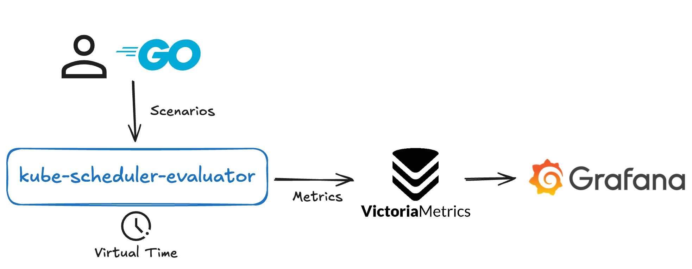
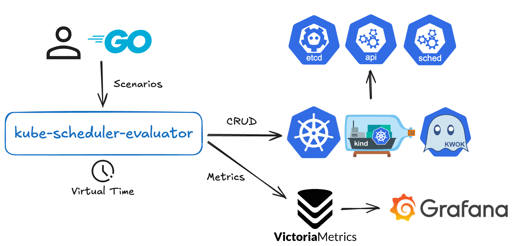

# kube-scheduler-evaluator

The kube-scheduler-evaluator is an evaluation tool for the Kubernetes scheduler.
It can execute defined scenarios against any scheduler and collect metrics.

It primarily has the following features:

- Scenarios can be defined using Go instead of YAML, enabling flexible and easy definition of large-scale and complex scenarios
  - For example, creating a scenario with 1000 nodes and 10,000 jobs can be easily defined using for loops
  - When different parameters are needed per node or job, values can be randomly generated within a specified range or jittered
- Internally manages virtual time, enabling fast scenario execution independent of real time while maintaining temporal consistency
  - For example, a scenario involving 1,000 jobs each taking 3 days to execute can run in seconds
- Multiple execution environments available
  - Since emulating controllers internally, evaluations can be executed with a single binary without preparing a Kubernetes cluster
  - External Kubernetes cluster mode is also available. Lightweight clusters such as kwok and kind can also be used
- Stable execution even for high-load scenarios
  - Robust operation achieved through API server load mitigation and internal instability absorption
  - Sequential processing of node/job creation/deletion events via channels reduces memory usage

## GPU allocation metrics

After GPU workload events and scheduler stabilization, the evaluator records
cluster-level GPU allocation metrics. The values are based on `nvidia.com/gpu`
Pod requests and node allocatable capacity, and their samples use virtual time
as the time-series timestamp. Unchanged allocation states are not emitted,
which keeps large scenarios compact.

The exported metrics are `gpu_allocatable_gpus`, `gpu_allocated_gpus`,
`gpu_free_gpus`, `gpu_allocation_percent`, and
`gpu_average_allocation_percent`. The last metric is the time-weighted average
from the first non-zero allocation through the final GPU workload completion.
All metrics carry `user_id`, `evaluation_id`, `scenario_id`, and `iteration`
labels.

These metrics describe scheduler allocation rather than physical GPU activity.
They are suitable for evaluating placement and fragmentation, while actual
device utilization requires a separate runtime telemetry source.

## Architecture



kube-scheduler-evaluator emulates controllers internally, enabling evaluations to be executed with a single binary without preparing a Kubernetes cluster. It receives multiple scenarios defined in Go from the user, executes CRUD operations on objects against internal controller while managing virtual time, and simultaneously sends metrics to time-series databases like Victoria Metrics.

## Quick Start

[kube-scheduler-evaluator-reference](https://github.com/pfnet/kube-scheduler-evaluator-reference) enables you to run reference scenarios locally using kube-scheduler-evaluator and docker-compose.

## How to Use

Import kube-scheduler-evaluator as shown below, implement a scenario generator function, and create a program to execute evaluations.
The scenario generator function receives an event channel and sends events to the channel to create or delete nodes and jobs (actually ReplicaSets).
Therefore, users can execute arbitrary scenarios by implementing the scenario generator function.
Use the `WithScenario` function to pass the scenario name, number of executions, scenario generator function, scheduler registry, and scheduler options to the kube-scheduler-evaluator.

For implementation details, refer to the [kube-scheduler-evaluator-reference](https://github.com/pfnet/kube-scheduler-evaluator-reference).

```go
package main

import (
  "context"
  "os"

  "github.com/pfnet/kube-scheduler-evaluator-reference/scenarios/clusterdata"
  "github.com/pfnet/kube-scheduler-evaluator-reference/scenarios/consts"
  "github.com/pfnet/kube-scheduler-evaluator-reference/scenarios/example"
  "github.com/pfnet/kube-scheduler-evaluator/cmd/evaluator"
  "github.com/pfnet/kube-scheduler-evaluator/pkg/definition"

  appsv1 "k8s.io/api/apps/v1"
  corev1 "k8s.io/api/core/v1"
  "k8s.io/kubernetes/pkg/scheduler"
  "k8s.io/apimachinery/pkg/api/resource"
  metav1 "k8s.io/apimachinery/pkg/apis/meta/v1"
  "k8s.io/kubernetes/pkg/scheduler/framework/runtime"
  "k8s.io/utils/ptr"
)

func main() {
  registry := runtime.Registry{
    yourCustomPlugin1.Name: yourCustomPlugin1.New,
    yourCustomPlugin2.Name: yourCustomPlugin2.New,
  }
  profiles, err := loadProfiles("YourKubeSchedulerConfiguration.yaml")
  if err != nil {
    panic(err)
  }
  eval, err := evaluator.New(
    evaluator.WithConfig(
      userID,
      kubeconfigPath,
      etcdPrefix,
      etcdURL,
      false, // disable externalMode
      slogLevel,
    ),
    evaluator.WithMetricStores(
      definition.NewMetricStore(definition.VictoriaMetrics, victoriaMetricsURL),
    ),
    // scenarioName, iteration, scenarioGenerator, schedulerRegistry, schedulerOptions
    evaluator.WithScenario(scenarioName1, 3, scenarioGenerator1, nil),  // default-scheduler
    evaluator.WithScenario(scenarioName2, 1, scenarioGenerator2, registry, scheduler.WithProfiles(profiles...)),  // your-custom-scheduler
  )
  if err != nil {
    panic(err)
  }
  code := eval.Run(context.Background())
  os.Exit(code)
}

func loadProfiles(path string) ([]schedulerapi.KubeSchedulerProfile, error) {
  // NOTE: Your Implementation to load scheduler profiles from KubeSchedulerConfiguration YAML file
}

func scenarioGenerator1(ch chan<- Event) {
  /*
    Create Nodes
  */
  for range numNode {
    node := &corev1.Node{
      ObjectMeta: metav1.ObjectMeta{
        GenerateName: "node-",
      },
      Status: corev1.NodeStatus{
        Capacity: corev1.ResourceList{
          corev1.ResourceCPU:    resource.MustParse(nodeCPU),
          corev1.ResourceMemory: resource.MustParse(nodeMem),
          corev1.ResourcePods:   resource.MustParse("110"),
          "nvidia.com/gpu":      resource.MustParse(nodeGPU),
        },
        Allocatable: corev1.ResourceList{
          corev1.ResourceCPU:    resource.MustParse(nodeCPU),
          corev1.ResourceMemory: resource.MustParse(nodeMem),
          corev1.ResourcePods:   resource.MustParse("110"),
          "nvidia.com/gpu":      resource.MustParse(nodeGPU),
        },
      },
    }
    node.SetGroupVersionKind(corev1.SchemeGroupVersion.WithKind("Node")) // NOTE: GVK should be explicitly set for logging
    event := NewEvent(
      EventTypeCreate,
      node,
      interval,
    )
    ch <- event // NOTE: Passing one event to the channel each time it is generated helps reduce memory usage.
  }

  /*
    Create Jobs
  */
  // NOTE: Jobs are immediately marked as Completed by kwok, so use ReplicaSet instead.
  // Preempted Pods are recreated by the ReplicaSet.
  for range numJob {
    podLabels := map[string]string{"app": "example-app"}
    replicaset := &appsv1.ReplicaSet{
      ObjectMeta: metav1.ObjectMeta{
        GenerateName: "job-",
        Namespace:    "default",
        Annotations: map[string]string{
          definition.DeadlineDurationAnnotationKey(userID): deadline.String(), // Deadline for the job
        },
      },
      Spec: appsv1.ReplicaSetSpec{
        // NOTE: A replicaset can only have one Pod. Having multiple Pods is not supported.
        Replicas: ptr.To[int32](1),
        Selector: &metav1.LabelSelector{
          MatchLabels: podLabels,
        },
        Template: corev1.PodTemplateSpec{
          ObjectMeta: metav1.ObjectMeta{
            Labels: podLabels,
            Annotations: map[string]string{
              definition.ExecutionDurationAnnotationKey(userID): execution.String(), // Execution time for the job
            },
          },
          Spec: corev1.PodSpec{
            SchedulerName: schedulerName,
            Containers: []corev1.Container{
              {
                Name:  "example-job",
                Image: "registry.example.com/example-job:1.0",
                Resources: corev1.ResourceRequirements{
                  Requests: corev1.ResourceList{
                    corev1.ResourceCPU:    resource.MustParse(podCPU),
                    corev1.ResourceMemory: resource.MustParse(podMem),
                    "nvidia.com/gpu":      resource.MustParse(podGPU),
                  },
                  Limits: corev1.ResourceList{
                    corev1.ResourceCPU:    resource.MustParse(podCPU),
                    corev1.ResourceMemory: resource.MustParse(podMem),
                    "nvidia.com/gpu":      resource.MustParse(podGPU),
                  },
                },
              },
            },
          },
        },
      },
    }
    replicaset.SetGroupVersionKind(appsv1.SchemeGroupVersion.WithKind("ReplicaSet"))
    event := definition.NewEvent(
      definition.EventTypeCreate, // EventTypeCreate, EventTypeDelete
      replicaset,
      interval,
    )
    ch <- event
  }
}
```

## `externalMode`



By default, the evaluator operates by emulating controllers internally. However, when `externalMode` is enabled, evaluations can be executed using an external Kubernetes cluster. To enable `externalMode`, pass `true` as the 5th argument to the `evaluator.WithConfig` function.
In this mode, kube-scheduler-evaluator communicates with the Kubernetes API server and sends node and job creation/deletion events to the external cluster. Besides using a real Kubernetes cluster, you can also use lightweight Kubernetes clusters (e.g., kwok, kind) to conduct evaluations while minimizing resource consumption.

Note that when using `externalMode`, scenario execution time may increase significantly. Additionally, be aware that a large number of requests may be sent to the external cluster's API server, so consider API server load balancing and rate limiting.

## 謝辞

この成果は、国立研究開発法人新エネルギー・産業技術総合開発機構（ＮＥＤＯ）の
「ポスト５Ｇ情報通信システム基盤強化研究開発事業」（JPNP20017）の委託事業の結果得られたものです。
